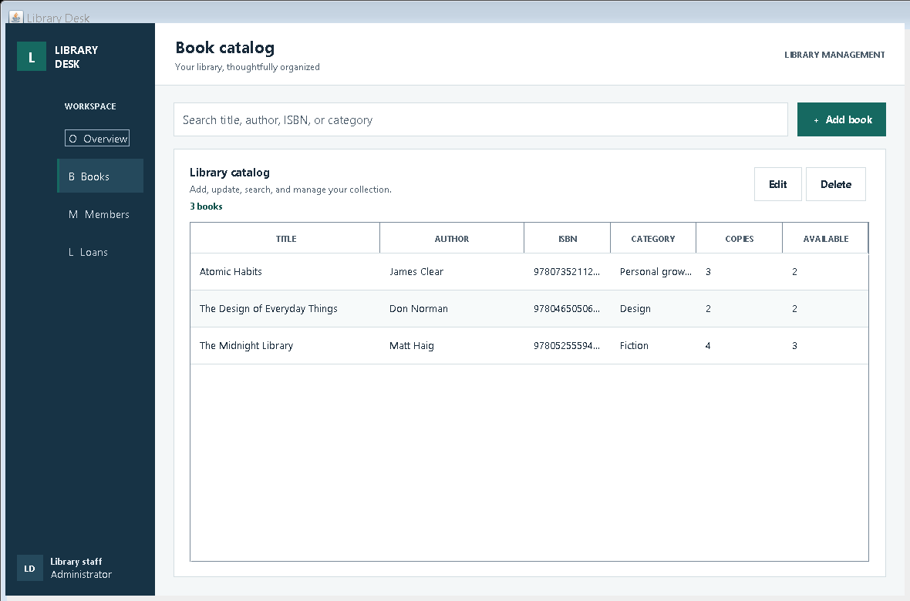
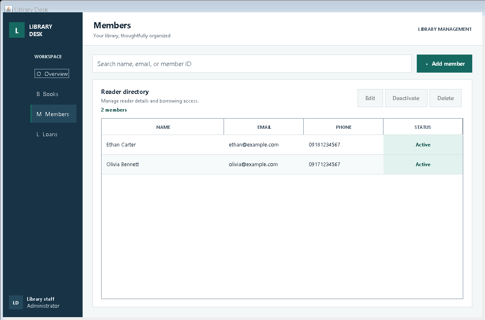
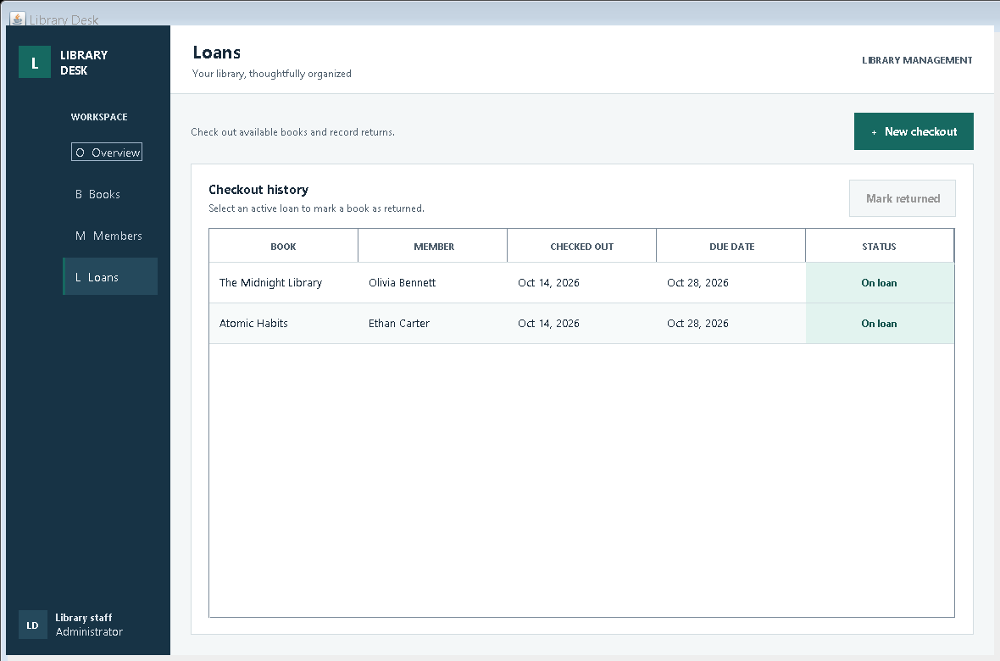
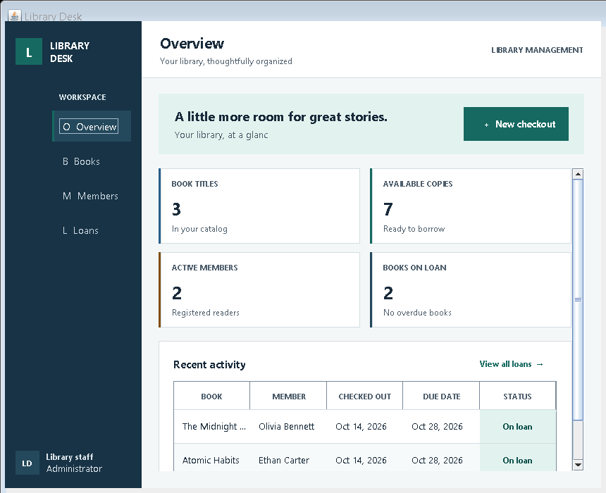
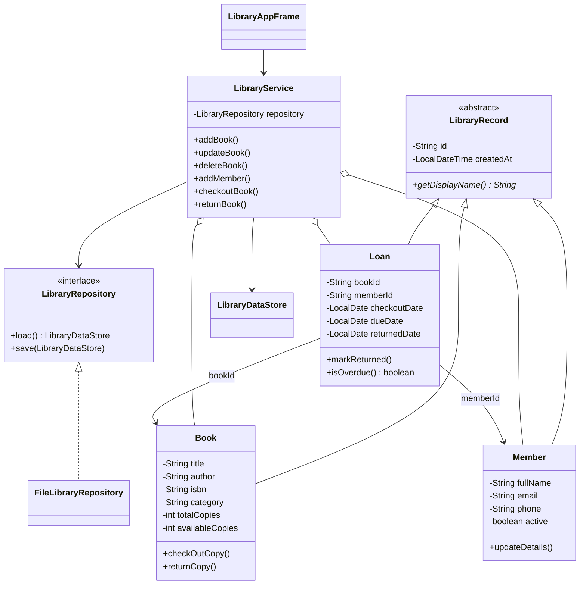

# Library Desk

A standalone Java Swing desktop application for managing a small library. This project is kept separate from the Laravel website in the repository root.

## Requirements

- JDK 17 or later
- Windows, macOS, or Linux with a graphical desktop session

No third-party libraries or database server are required. Records are saved locally to `.library-management/library-data.ser` under the current user's home directory.

## Run on Windows

Open PowerShell in this folder and run:

```powershell
$output = "out"
New-Item -ItemType Directory -Path $output -Force | Out-Null
$sources = Get-ChildItem "src\main\java" -Recurse -Filter "*.java" | ForEach-Object FullName
javac -encoding UTF-8 -d $output $sources
java -cp $output com.folio.library.Main
```

## Features

- Overview dashboard with catalog, available-copy, active-member, and active-loan metrics.
- Book catalog: add, view, search, update, and delete book records.
- Member directory: add, view, search, update, remove from the directory, and activate/deactivate members. Removed readers with returned checkout history are archived so their names remain in loan records.
- Loan desk: check out available books, view loan history, and record returns.
- Automatic 14-day due dates; overdue status appears in the dashboard and loan history.
- Local persistence using an atomic file replacement; seeded starter records are added only to a new library.
- Business-rule checks prevent duplicate ISBNs/emails, unavailable or inactive-member checkouts, more than three active loans per member, and removing readers with active checkouts. Returned-loan history stays linked to archived readers.

## Object-oriented design

- **Encapsulation:** domain fields are private; controlled getters and operations maintain each record's state.
- **Abstraction:** `LibraryRecord` defines shared record identity and the `getDisplayName()` contract. `LibraryRepository` abstracts data storage from business logic.
- **Inheritance:** `Book`, `Member`, and `Loan` extend `LibraryRecord`.
- **Polymorphism:** record types provide their own display-name behavior; the application uses the `LibraryRepository` interface so storage implementations can be substituted.
- **Object methods:** `LibraryRecord` provides identity-based `equals` and `hashCode` using both the record type and its stable ID. Its `toString` uses the subclass's display name, demonstrating polymorphism without exposing private contact details.
- **Separation of responsibilities:** `domain` contains records, `service` enforces library rules, `storage` persists records, and `ui` owns Swing presentation.

## Validation and error handling

Required text, ISBN format, email format, duplicate identifiers, copy counts, and transaction eligibility are validated by `LibraryService`. User-facing errors are shown in the relevant form or action. Storage errors are reported instead of being treated as successful saves. Records with circulation history are retained so that checkout history remains meaningful.

## Visual design and accessibility

The interface applies the color-theory, visual-design, and universal-design principles in the supplied HCI course materials:

- **Intentional color harmony:** a low-saturation sage and cream family carries most surfaces and navigation. Deep forest green anchors primary actions and navigation; a restrained amber provides a distinct secondary data accent, and red is reserved for overdue or inactive attention states.
- **Defined palette:** forest ink `#2F3E34` anchors the interface, with sage `#7F9C86` and pale sage `#BFD0B3` accents. Cream `#FFF1D2` and warm beige `#E9DAB6` provide light surfaces and dividers; amber `#814D14` and red `#A93531` retain their distinct status meanings.
- **Color value and accessible contrast:** typography uses dark, high-contrast ink on light surfaces. Status colors pair with explicit words, never color alone. `LibraryUiDesignTest` measures relative luminance and checks 12 text/foreground combinations against the WCAG AA 4.5:1 normal-text threshold.
- **Hierarchy, consistency, and grouping:** page headings, instructional labels, metric cards, related actions, table headings, and consistent spacing make the next action easy to find and the same controls behave alike across screens.
- **Readable, perceptible feedback:** search fields have visible prompts and accessible names; search result counts, empty states, validation dialogs, saved confirmations, and explicit loan-status labels keep the result of an action clear.
- **Keyboard and motor accessibility:** inputs and action buttons have generous hit areas, a distinct high-contrast keyboard-focus outline, labels, tooltips, and accessible names. The dashboard rearranges its four metric cards into a two-by-two grid at narrower window widths.
- **Error prevention and recovery:** incomplete or invalid records are rejected before saving; destructive deletions require confirmation; member activation can be reversed; loan status, due dates, and return actions provide clear circulation context.

## GUI screenshots

Dashboard:


Book catalog:



Member directory:



Loans:



Compact dashboard:



## UML class diagram



## Test business rules and persistence

The dependency-free test runner checks validation, uniqueness, checkout limits, member status, returns, search, and persistence:

```powershell
$output = "out"
New-Item -ItemType Directory -Path $output -Force | Out-Null
$sources = Get-ChildItem "src" -Recurse -Filter "*.java" | ForEach-Object FullName
javac -encoding UTF-8 -d $output $sources
java -ea -cp $output com.folio.library.service.LibraryServiceTest
java -ea -cp $output com.folio.library.ui.LibraryUiDesignTest
```

The GUI screenshots in [`screenshots/`](screenshots/) can be regenerated from a desktop session:

```powershell
$output = "out"
New-Item -ItemType Directory -Path $output -Force | Out-Null
$sources = Get-ChildItem "src" -Recurse -Filter "*.java" | ForEach-Object FullName
javac -encoding UTF-8 -d $output $sources
java -cp out com.folio.library.ui.LibraryScreenshotGenerator screenshots
```
