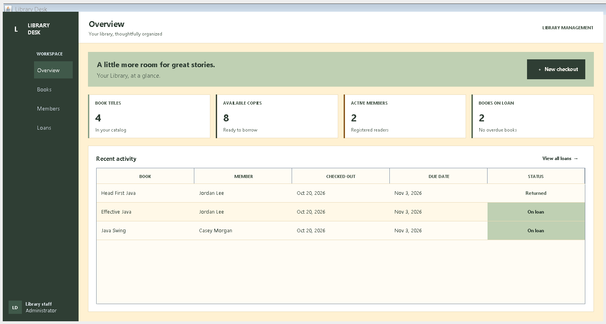

# Library Desk

**Library Desk** is a Java Swing desktop application for organizing a small library's catalog, members, and book loans. It was developed as an Object-Oriented Programming course project to demonstrate the four pillars of OOP in a working GUI application.

| Project detail | Description |
| --- | --- |
| Language | Java |
| Interface | Java Swing |
| Java version | JDK 17 or later |
| Persistence | Local file storage in the user's home directory |
| External dependencies | None |

## Application preview



The demo data shown in the screenshots contains **five book titles, 13 total copies, 11 available copies, two active members, and three loan-history records**. The Java search view is intentionally filtered and shows **three matching books**; the unfiltered catalog shows all five.

## Features

- **Dashboard:** view catalog, available-copy, active-member, active-loan, and overdue-loan totals, plus recent loan activity.
- **Book catalog:** add, search, edit, and delete book records; search by title, author, ISBN, or category.
- **Member directory:** add and search members, update member details, activate or deactivate accounts, and manage member records.
- **Circulation:** check out available books to active members and record returns. Loans have a 14-day due date.
- **Validation and error handling:** reject invalid or duplicate ISBNs and member emails, invalid copy counts, unavailable books, and checkouts that violate member or loan rules.
- **Persistence:** save library records locally so they remain available after the application is closed and reopened.

## Object-oriented design

| OOP pillar | Implementation |
| --- | --- |
| Encapsulation | `Book`, `Member`, and `Loan` keep their state in private fields and expose controlled methods. `LibraryService` returns copies of records so callers cannot mutate its stored objects directly. |
| Inheritance | `Book`, `Member`, and `Loan` extend the abstract `LibraryRecord` class, sharing record identity and creation-time behavior. |
| Polymorphism | Each record subtype implements `getDisplayName()`. Code can work with different record types through the `LibraryRecord` abstraction. |
| Abstraction | `LibraryRecord` defines shared abstract record behavior. The `LibraryRepository` interface separates library operations from the `FileLibraryRepository` persistence implementation. |

### Project structure

```text
src/
├── main/java/com/folio/library/
│   ├── domain/     # Book, Member, Loan, and LibraryRecord
│   ├── service/    # Library workflows, rules, and validation
│   ├── storage/    # Repository abstraction and file persistence
│   └── ui/         # Swing application and screens
└── test/java/      # Service checks, UI checks, and screenshot generator
docs/               # Project report and UML class overview
screenshots/        # Application screenshots
```

## Run the application

**Requirements:** JDK 17 or later and a graphical desktop session.

From PowerShell in the project root:

```powershell
$output = "out"
New-Item -ItemType Directory -Path $output -Force | Out-Null
$sources = Get-ChildItem "src\main\java" -Recurse -Filter "*.java" | ForEach-Object FullName
javac -encoding UTF-8 -d $output $sources
java -cp $output com.folio.library.Main
```

The application stores its data at `.library-management\library-data.ser` under the current user's home directory. The screenshot generator uses a separate temporary home and does not overwrite that data.

## Run the checks

From PowerShell in the project root:

```powershell
$output = "out"
New-Item -ItemType Directory -Path $output -Force | Out-Null
$sources = Get-ChildItem "src" -Recurse -Filter "*.java" | ForEach-Object FullName
javac -encoding UTF-8 -d $output $sources
java -ea -cp $output com.folio.library.service.LibraryServiceTest
java -ea -cp $output com.folio.library.ui.LibraryUiDesignTest
```

The service checks exercise validation, circulation rules, record behavior, and persistence. The UI checks verify text contrast and primary-button rendering.

## Project documentation

- [Print-ready project report](docs/Library%20Desk%20Project%20Documentation%20-%20Print%20Ready.docx) — project description, problem, objectives, features, OOP implementation, UML, GUI screenshots, and testing.
- [UML class overview](docs/Library%20Desk%20UML%20Overview.png)

## Screenshots

- [Dashboard](screenshots/01-dashboard.png)
- [Full book catalog](screenshots/02-books.png)
- [Books matching the Java search](screenshots/03-book-search.png)
- [Member directory](screenshots/04-members.png)
- [Loan history](screenshots/05-loans.png)

To regenerate the screenshots from a graphical desktop session, compile the project and run:

```powershell
$output = "out"
New-Item -ItemType Directory -Path $output -Force | Out-Null
$sources = Get-ChildItem "src" -Recurse -Filter "*.java" | ForEach-Object FullName
javac -encoding UTF-8 -d $output $sources
java -cp out com.folio.library.ui.LibraryScreenshotGenerator screenshots
```

The generator uses isolated demo records and replaces the screenshot files in `screenshots/`.
